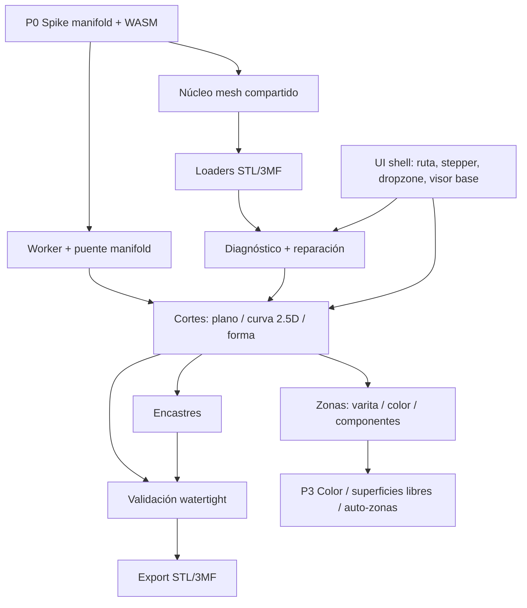

# Plan de implementación — Módulo Cortador

## 1. Requisitos

Herramienta client-side que toma un STL o 3MF, lo normaliza a mm y Z-up, lo repara
con reporte visible por etapas, permite definir zonas y cortes rectos, curvos o
por forma con encastres, y exporta piezas watertight en STL o un 3MF con color.
Sin backend ni subida de archivos.

### MVP usable (cierra en P1)

- Import STL binario/ASCII y 3MF (objetos, componentes, transformaciones,
  unidades, materiales) por botón y drag & drop.
- Límites duros 120 MB / ~3M triángulos.
- Diagnóstico inicial: triángulos, bbox, componentes, bordes abiertos, no
  manifold, volumen y orientación.
- Funciones de color deshabilitadas con explicación cuando el input es STL.
- Reparación por etapas con métrica antes/después: weld, limpieza, orientación,
  huecos, no manifold, auto-intersecciones, componentes/polvo y validación final.
- Gate: si no queda watertight, no se exporta. Sin override.
- Visor con órbita, sección, selección de caras, gizmo de plano con snapping,
  vista explotada, aislamiento y medición.
- Zonas básicas: componentes, regiones por color 3MF y **varita 3D** (click +
  similitud con tolerancia, contiguo/global, sumar/restar, overlay y "separar
  zona").
- Cortes rectos, curvos 2.5D y por forma, simples y múltiples, con lado a
  conservar, tapas y reorden.
- Export STL por pieza, 3MF con color, layout y reporte de ensamblaje.
- Proyecto como JSON de operaciones en IndexedDB; undo/redo determinístico.

### Must que cierra en P2

Espiga cilíndrica + alojamiento, chaveta, cola de milano, reglas de colocación,
holguras 0.10/0.15/0.25 mm, chaflán, cupón de tolerancia, validación de encastres,
vista explotada y leyenda.

### Fuera de alcance

Color/forma/auto-zonas (P3), imán/snap-fit, escultura, soportes, slicing, nesting,
backend, STEP/OBJ/PLY.

## 2. Decisiones de arquitectura

1. **CSG: `manifold-3d` (WASM) en Web Worker.** Única fuente de geometría
   exportable. `three-bvh-csg` solo preview o plan B; nunca exporta.
2. **Worker persistente y lazy.** Se crea al cargar/reparar, se reutiliza para no
   reinicializar WASM. Buffers transferibles. Cancelar = terminar y recrear, con
   `jobId` para descartar respuestas viejas.
3. **Núcleo de malla compartido en `src/lib/mesh/`.** `weld`, `analyze`, `repair`,
   bounds y topología pasan a ser fuente única. `src/lib/texturizer/subdivide.ts`
   mantiene re-exports para no romper el Texturizador.
4. **Gate watertight en la frontera de exportación**, sobre la malla exacta que se
   descarga. No se valida el preview.
5. **Preview por clipping planes; CSG real solo al presionar Aplicar.** Evita
   recalcular booleanos en cada arrastre.
6. **Proyecto = log de operaciones**, no la malla. Undo/redo y reapertura
   determinística sin inflar IndexedDB.
7. **Reparación visible por etapas.** Ninguna corrección silenciosa.
8. **3MF primario para color/partes; STL solo geometría.**
9. **Todo corte se compila a un sólido cortador cerrado.** Plano → caja/medio
   espacio; curva 2.5D → prisma de pared curva; forma → prisma de contorno;
   superficie libre → cuchilla cerrada. Manifold solo hace booleanos contra esos
   sólidos. No existe "corte abierto".
10. **Varita 3D como mecanismo primario de zonas**, con el mismo patrón de
    interacción que la varita de Imagen: semilla + crecimiento por similitud +
    tolerancia + contiguo/global + sumar/restar + overlay. "Separar zona" corta
    por el borde de la selección y cierra con una superficie de corte.
11. **Curva 2.5D y forma en P1; loft/sweep/heightfield/seguir pieza en P3.**

## 3. DAG

La UI shell puede empezar en paralelo con P0; el motor no.

## 4. Fases

### P0 — Spike del motor (2–3 d)

1. Leer `node_modules/next/dist/docs/` sobre workers, assets WASM y
   `output: "export"` antes de escribir código. Verificar Turbopack.
2. Instalar `manifold-3d`. Fijar versión exacta tras el spike.
3. Script de humo `scripts/spike-manifold.mjs`: inicializar WASM, crear un cubo,
   `splitByPlane` por la mitad y por un plano diagonal, validar 2 sólidos,
   volúmenes 50/50 ±0.1 %, watertight y status OK. Repetir con un prisma de pared
   curva (corte curvo 2.5D) y con una esfera de ~80k triángulos. Confirmar firmas
   reales (`splitByPlane`, `trimByPlane`, `getMesh`, `volume`, `status`,
   `Mesh.merge`, `Manifold.ofMesh`).
4. Repetir con un modelo real (cascanueces) en STL y 3MF.
5. Medir: tiempo de init, tiempo de split de 100k/1M triángulos, memoria y peso
   del WASM.
6. Verificar carga en navegador en `npm run dev` y con `GITHUB_PAGES=1 npm run
   build` (basePath `/tool3d`). Resolver el `.wasm` desde `public/wasm/` o con
   `locateFile`, según lo que funcione.
7. Go / no-go. Si es no-go, ejecutar el plan B (sección 11) antes de tocar la UI.
8. Borrar el script temporal y registrar la decisión en `docs/DECISIONS.md`.

**Verificación:** split correcto, sin fugas de memoria, build estático OK,
`npx tsc --noEmit`, `npm run lint`.

**Estado P0 (2026-10-24): COMPLETADO.** `manifold-3d@3.5.4` instalado. Spike en Node OK:
init 14–20 ms; cubo 12 tri partido en 7.6–8.4 ms con volúmenes 4000/4000; plano
diagonal y roundtrip `getMesh`/`ofMesh` exactos; prisma de pared curva (corte
2.5D, 248 tri) parte el cubo en 3972.626 + 4027.374 mm³, ambas `NoError`; esfera
de 80k tri partida en ~330 ms; malla abierta rechazada con "Not manifold"
(confirma que la reparación previa y el gate son obligatorios). Hallazgo: los
contornos de `CrossSection.ofPolygons` deben ir en CCW; en CW devuelve
`InvalidConstruction` y volumen 0 (ver `docs/TROUBLESHOOTING.md` §16).
Verificado en navegador (dev y export estático con `GITHUB_PAGES=1` + basePath
`/tool3d`): worker + WASM cargan, `#smoke-result` = `done` con los mismos
volúmenes y todos los estados `NoError`; init 101.6 ms, cubo 6.6 ms, curva
4.5 ms, esfera 80k 328 ms, sin excepciones. El split de 80k tri en ~330 ms
sugiere que 1M puede superar el objetivo de 2 s; medir en P1 y, si hace falta,
ajustar el objetivo o usar preview decimado con CSG diferido.

### P1 — MVP usable (7–9 d)

1. **Vitest** (`vitest`, `@vitest/coverage-v8`) + `vitest.config.ts` (entorno
   node para `src/lib`), scripts `test` y `test:coverage`.
2. **Núcleo mesh**: crear `src/lib/mesh/{types,bounds,weld,topology,repair,holes,
   components}.ts`; mover weld/analyze/repair desde `subdivide.ts`; dejar
   re-exports y correr la suite existente del Texturizador.
3. **Loaders**: `io/stl.ts` (reutilizar límites de `load-stl.ts`), `io/threemf-read.ts`
   (3MFLoader + fallback `fflate` + `DOMParser`), normalización mm/Z-up y
   diagnóstico.
4. **Tipos de operaciones**: `src/lib/cutter/types.ts` (`Operation`, `Zone`,
   `WandSettings`, `CutSurface`, `Cut`, `Joint`, `Piece`, `Project`),
   `project.ts` (IndexedDB, JSON) y `operations.ts` (undo/redo, hash, cache).
5. **Worker**: `cutter/worker.ts` + `worker-client.ts`; `jobId`, progreso,
   cancelación, transferibles; `manifold.ts` como puente.
6. **Cortes**: `cutter-solid.ts` (contrato de sólido cerrado),
   `cut-plane.ts` (plano), `cut-curve.ts` (spline 2.5D → prisma de pared curva),
   `cut-shape.ts` (contorno/silueta → prisma). Validar auto-intersección, radio
   mínimo, espesor de cuchilla y cobertura de la pieza antes del booleano.
   Tapas, lado a conservar, cortes múltiples en secuencia, reorden/desactivar.
7. **Varita 3D**: `zones.ts` con crecimiento de región por similitud (color,
   diedro, normal, curvatura), tolerancia, contiguo/global, expandir/contraer,
   sumar/restar y extracción del borde. Mismo patrón de interacción que la varita
   de Imagen (`floodFillByColor`, atajo W, slider de tolerancia). "Separar zona"
   reutiliza el pipeline de `cut-shape.ts` para cortar por el borde y cerrar.
8. **Validación**: `validate.ts` (bordes abiertos, no manifold, volumen, normales,
   suma de volúmenes ±0.5 %). Gate de export.
9. **Export**: `io/export-stl.ts` binario por pieza; `io/threemf-write.ts`
   (base `src/lib/3d/threemf.ts`) con piezas y color; `layouts.ts`.
10. **UI**: `src/app/tools/cortador/page.tsx`; `cortador-tool.tsx` con stepper
    (@stepperize/react); `import-dropzone.tsx`; `repair-report.tsx`;
    `zone-panel.tsx` (incluye la varita 3D); `cut-panel.tsx` (plano/curva/forma);
    `pieces-panel.tsx`; `export-panel.tsx`.
11. **Visor**: `cortador-viewer.tsx` con sección, selección, overlay de varita,
    gizmo numérico y por arrastre, explotado y aislamiento. Preview decimado.
12. **Registry**: alta en `src/lib/tools/registry.ts` (slug `cortador`, `3d`,
    `available`, icono `Scissors`).
13. **Tests geométricos**: cubo/esfera/toro + cubo abierto + auto-intersectado;
    split por plano, prisma curvo y prisma de forma; volúmenes, orientación,
    huecos, varita (contiguo/global/sumar/restar), roundtrip 3MF.
14. **Cierre**: `npx tsc --noEmit`, `npm run lint`, `npm run build`,
    `GITHUB_PAGES=1 npm run build`, `npm test`.

**Verificación:** AC-001 a AC-008, AC-012 a AC-023 y AC-025 a AC-026.

**Estado P1 (2026-10-24): COMPLETADO.** Vitest 3.2.7 con 26 tests (mesh,
split recto/curvo/forma, varita, sugerencia, reporte). Implementado: núcleo
`src/lib/mesh`, loaders STL/3MF con unidades y color por triángulo, worker
manifold, cortes rectos/curvos/forma/zona, colocación de planos por sombra y
clic, varita 3D, vista explotada automática, reorden, undo/redo, guardado de
proyecto con archivo fuente en IndexedDB, cancelación, export STL/3MF, informe
de ensamblaje y sugerencia de planos por barrido de sección. Verificado en
navegador (dev y export estático con basePath) sin excepciones. Pendiente de
P1: lector 3MF de respaldo, preview decimado, expandir/contraer la varita y
validación de curvas auto-intersectadas.

**Interacción con mouse (2026-10-24).** Agregada manipulación directa en el
visor: los planos se arrastran sobre el modelo (o se ubican por sombra y clic),
las ondas y las formas se colocan haciendo clic en la pieza, las piezas se
mueven arrastrándolas con el modo «Mover» y la varita pinta zonas arrastrando,
sumando con Shift y restando con Alt. La selección pintada se recalcula con
`zoneFromFaces` y conserva borde cerrado para separar la zona. Verificado con
CDP: plano colocado y arrastrado, forma y pieza movida, zona pintada de 46 caras
y cortes resultantes sin excepciones.

**Gizmo estilo OrcaSlicer (2026-10-24).** Los planos admiten normales
arbitrarias. El plano activo muestra un aro ámbar: arrastrar el cuerpo lo
desplaza y arrastrar el aro (o usar Shift) lo inclina sobre el punto de pivote.
Un panel flotante con «Aplicar corte» ejecuta el corte sin salir del visor; el
plano sigue disponible como tarjeta con sliders y posición numérica. Verificado
con CDP: inclinación de 34° y corte resultante en 2 piezas.

### P2 — Encastres y ensamblaje (4–6 d)

1. `joints.ts`: espiga + alojamiento; chaveta; cola de milano.
2. Colocación automática por cara con inset 1.2 mm, separación 3×d, diámetro
   ≤ 1/3 del ancho, largo ≤ min(8 mm, 40 %).
3. Booleanos de espiga/alojamiento en worker; revalidar cada pieza.
4. Presets de holgura, chaflán y cupón de tolerancia exportable.
5. Validación: exterior, colisiones entre cortes/encastres, voladizo.
6. `joint-panel.tsx`, vista explotada, reporte de ensamblaje.

**Verificación:** AC-009 a AC-011 y AC-014.

**Estado P2 (parcial, 2026-10-24).** Implementado en `split.ts`: espiga
cilíndrica y variante con chaveta, cantidad 1–4 con separación 3×diámetro,
largo ≤ min(8 mm, 40 %), holgura configurable, aviso explícito cuando el
encastre no cabe y revalidación watertight por pieza. Agregado el informe de
ensamblaje descargable. Pendiente: cola de milano, chaflán de entrada, cupón de
tolerancia y validación de exterior/colisiones/voladizo.

### P3 — Color, superficies libres y auto-zonas (5–9 d)

1. Regiones por color 3MF y separación por islas.
2. Corte por color: relieve/bolsillo (default) y Voronoi de vóxeles (avanzado).
3. Superficies de corte libres (`cut-surface.ts`): loft entre dos curvas, sweep de
   un perfil por un path, heightfield y corte que sigue la superficie/cresta de la
   pieza. Todo se cierra como cuchilla sólida antes del booleano.
4. Sugerencia automática de planos (barrido X/Y/Z + PCA, scoring de área, loops y
   espesor).
5. Pincel de zonas, simetría y concavidad.
6. Separación automática por uniones cóncavas entre formas.

**Verificación:** muestras multicolor Bambu/Orca; volúmenes y watertight.

**Estado P3 (parcial, 2026-10-24).** Implementada la sugerencia automática de
planos (`suggest.ts`): barrido de 15 secciones por eje con volumen de la
intersección, detección de valles y hasta 3 planos propuestos. La varita ya
selecciona por color 3MF y separa la zona como relieve. El pincel de zonas ya
permite pintar arrastrando y sumar/restar con Shift/Alt; falta el radio de
pincel y la simetría.

Implementada también la separación automática (`seams.ts`): detecta aristas
cóncavas con diedro ≥ 32°, agrupa el borde en loops cerrados, ajusta un plano
por Newell y valida cada candidato partiendo la malla; si no hay uniones
cóncavas cae en `suggestCuts`. La UI expone «Separar formas automáticamente» y
aplica los planos en un solo paso. El signo de concavidad se calibró con un cubo
(0 uniones) y con una esfera + cilindro fundidos: 1 unión detectada y 2 piezas
watertight en 118 ms. Tests: 26 en total.

Pendiente: separación volumétrica por color/Voronoi, superficies libres
(loft/sweep/heightfield), seguir cresta, radio de pincel y simetría.

### P4 — Pulido y QA (2–3 d)

Presets, textos, accesibilidad, docs (`ARCHITECTURE`, `DECISIONS`,
`TROUBLESHOOTING`), QA en Bambu Studio, Orca y Cura, ajuste de umbrales y cupón
impreso.

## 5. Dependencias

| Dependencia | Uso | Cuándo |
|---|---|---|
| `manifold-3d` | CSG y split watertight | P0 |
| `vitest`, `@vitest/coverage-v8` | Tests del núcleo | P1 |
| `three` (ya instalado) | STLLoader, 3MFLoader, visor | P1 |
| `fflate` / `jszip` (ya) | 3MF fallback y escritura | P1 |
| `clipper-lib`, `cdt2d`/earcut (ya) | Limpieza y tapas | P1 |
| `@stepperize/react`, radix/shadcn (ya) | UI | P1 |
| Archivos de prueba | cascanueces STL/3MF, cubo abierto, auto-intersectado, multicolor | P0/P1 |

Sin servicios externos ni variables de entorno.

## 6. Riesgos

| Riesgo | Prob. | Impacto | Detección temprana | Mitigación |
|---|---|---|---|---|
| WASM no carga con `output: export` + basePath | Media | Alto | P0, paso 6 | `public/wasm` + `locateFile`; build estático en el spike |
| Worker no bundlea con Turbopack | Media | Alto | P0 | `new Worker(new URL(...), {type:"module"})`; fallback a worker clásico |
| manifold rechaza mallas no manifold | Alta | Alto | P0 con modelo real | Reparación previa + remesh por vóxeles; gate |
| Memoria/tiempo en 1M triángulos | Alta | Alto | P0 benchmark | Límites, LOD, cache, cancelación |
| 3MFLoader pierde materiales/transformaciones | Media | Alto | P1 con 5 archivos reales | Lector propio `fflate` + `DOMParser` |
| Encastres que no calzan | Alta | Medio | P2 con cupón impreso | Presets + chaflán + cupón |
| Curva o cuchilla auto-intersectada | Media | Alto | P1 con spline en S | Validación de radio/espesor y rechazo (AC-025) |
| Borde de zona de varita no cerrado | Media | Medio | P1 con zona de color | Rechazo explícito + cierre por superficie de corte |
| Explosión de triángulos en cortes curvos | Media | Medio | P1 benchmark | Teselado adaptativo, preview decimado, presupuesto |
| Regresiones geométricas invisibles | Media | Alto | P1 Vitest | Golden meshes + property tests |
| Scope creep | Alta | Medio | Revisión semanal | MVP congelado hasta P2 |

## 7. Estrategia de tests

- **Unitarios (Vitest, node):** weld, analyze, orientación por volumen, cierre de
  huecos planos, componentes, volumen, split por plano, split por prisma curvo y
  por prisma de forma, winding de tapas, varita (semilla, tolerancia,
  contiguo/global, sumar/restar, borde), colocación de encastres, roundtrip 3MF.
- **Property tests:** plano aleatorio que cruza un cubo → 2 piezas, watertight,
  suma de volúmenes ±0.5 %, normales outward; spline aleatoria simple dentro de
  la silueta → 2 piezas watertight.
- **Integración:** importar → reparar → corte recto + curvo + zona de varita →
  encastre → exportar → reimportar → validar.
- **Golden meshes:** cubo, esfera y toro procedurales; cubo con una cara faltante;
  auto-intersectado; cascanueces real STL y 3MF multicolor.
- **Manual (slicer):** abrir STL/3MF en Bambu Studio, Orca y Cura sin reparar;
  imprimir cupón de tolerancia.
- **CI:** no configurado; los tests corren localmente y en el cierre de cada fase.

## 8. Mapa de criterios de aceptación

| AC | Paso del plan | Verificación |
|---|---|---|
| AC-001 Import STL | P1.3 | Manual + Network vacío |
| AC-002 Import 3MF | P1.3 | Comparar con Bambu + conteo de objetos |
| AC-003 Diagnóstico | P1.2–1.3 | Archivo preparado + reporte |
| AC-004 Reparación | P1.2 | Reporte + reanálisis |
| AC-005 No reparable | P1.2, P1.7 | Export bloqueado + remesh ofrecido |
| AC-006 Corte simple | P1.6 | Volúmenes ±0.5 % + watertight |
| AC-007 Cortes múltiples | P1.6 | 4 piezas + determinismo |
| AC-008 Zonas manuales | P1.9 | Resaltado + lista |
| AC-009 Espiga | P2.1–2.3 | Sección + watertight |
| AC-010 Variantes | P2.1 | Geometría + volúmenes |
| AC-011 Validación encastres | P2.5 | Mensaje por regla |
| AC-012 Gate watertight | P1.7 | Descarga ausente + pieza roja |
| AC-013 Export STL | P1.8 | Reimportar en app y Cura |
| AC-014 Export 3MF | P1.8 / P2 | Bambu + Orca + XML del ZIP |
| AC-015 Archivo inválido | P1.3 | Proyecto intacto |
| AC-016 STL sin color | P1.9 | Opción deshabilitada |
| AC-017 Rendimiento | P0 + P1 | `performance.now()` + DevTools |
| AC-018 Cancelación | P1.5 | Worker terminado + estado restaurado |
| AC-019 Undo/proyecto | P1.4 | Volúmenes + recarga |
| AC-020 Repo | Cada fase | tsc, lint, build |
| AC-021 Tests geometría | P1.1, P1.13 | Salida Vitest + cobertura |
| AC-022 Corte curvo 2.5D | P1.6 | Spline + watertight + volúmenes |
| AC-023 Corte por forma | P1.6 | Contorno/silueta + watertight |
| AC-024 Seguir pieza | P3.3 | Sección + validación + slicer |
| AC-025 Curva inválida | P1.6 | Rechazo por motivo |
| AC-026 Varita 3D | P1.7 | Overlay + separar + watertight |

## 9. Definition of Done (MVP P1)

- Un usuario carga un STL y un 3MF, ve el diagnóstico, repara, corta en 2–4
  piezas con cortes rectos, curvos o por forma (o separando una zona con la
  varita), y exporta STL/3MF.
- Todas las piezas exportadas pasan validación watertight; la suma de volúmenes
  está dentro de ±0.5 %.
- Los archivos abren en Bambu Studio, Orca y Cura sin reparaciones.
- UI en español, estados de progreso/error/cancelación, sin bloqueos del hilo
  principal.
- `npx tsc --noEmit`, `npm run lint`, `npm run build`, build estático y `npm test`
  pasan.
- Sin backend, sin uploads, sin secretos.

## 10. Estimación

| Fase | Esfuerzo | Camino crítico |
|---|---|---|
| P0 | 2–3 d | Sí: bloquea todo |
| P1 | 7–9 d | Sí |
| P2 | 4–6 d | Parcial |
| P3 | 5–9 d | No para el MVP |
| P4 | 2–3 d | Cierre |
| **Total** | **20–30 d** | MVP en ~2.5 semanas |

Quick wins: diagnóstico + reparación visibles desde el día 1; corte recto único
antes de múltiples; corte curvo 2.5D después del plano; varita antes de auto-zonas;
export STL antes de 3MF; encastre manual antes de automático.

## 11. Plan B si manifold-3d falla

1. **WASM no carga:** mover el binario a `public/wasm/`, inicializar con
   `locateFile`, verificar basePath; si persiste, usar el build single-file.
2. **Worker no bundlea:** worker clásico con script en `public/` o
   `worker-loader`; última opción, CSG en el hilo principal con chunking.
3. **Motor inviable:** splitter propio (Sutherland–Hodgman para planos y prisma
   de curva/forma con tapas vía clipper/earcut) y `three-bvh-csg` para encastres,
   con reparación posterior obligatoria y el mismo gate. Se pierde la garantía por
   construcción: más tests y validación estricta.
4. **Mallas no manifold:** remesh por vóxeles antes de cualquier booleano.

Nunca se relaja el gate de exportación.

## 12. Checklist del primer día

1. Leer la documentación de Next 16 sobre workers, assets y `output: export`.
2. `npm install manifold-3d` y `npm install -D vitest @vitest/coverage-v8`.
3. Escribir `scripts/spike-manifold.mjs` y validar cubo partido por la mitad y
   por un prisma de pared curva.
4. Medir init, split y memoria; confirmar firmas de la API.
5. Probar un cascanueces STL y un 3MF real.
6. Verificar en `npm run dev` y en `GITHUB_PAGES=1 npm run build`.
7. Go/no-go; si no-go, ejecutar plan B antes de la UI.
8. Crear `src/lib/mesh/` y migrar weld/analyze/repair con re-exports.
9. Configurar Vitest y el primer test del núcleo.
10. Reportar resultados y seguir con P1.
